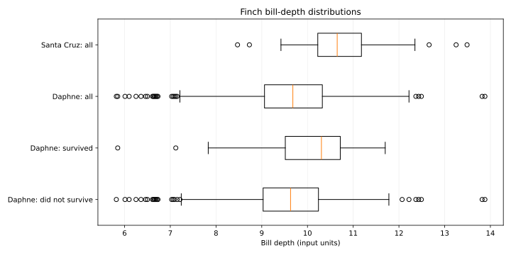

# Finch Bill-Depth Analysis

A Python exploratory analysis of bill-depth variation across Daphne and Santa Cruz, including comparisons between surviving and non-surviving Daphne birds.

## Features

- Summarizes sample sizes, means, medians, sample standard deviations and ranges.
- Compares bill-depth distributions using box plots.
- Calculates the observed survival fraction and differences in mean bill depth.
- Validates binary group codes, positive measurements and paired missing values.
- Exports CSV summaries, JSON metrics and an SVG chart.
- Includes a fictional example and six automated tests.

## Results

| Group | Observations | Mean bill depth |
|---|---:|---:|
| Daphne: did not survive | 661 | 9.5901 |
| Daphne: survived | 90 | 10.0859 |
| Daphne: all | 751 | 9.6495 |
| Santa Cruz: all | 43 | 10.7702 |

The observed Daphne survival fraction is **11.98%**. Survivors have a mean bill depth **0.4958 input units** greater than non-survivors, and **0.4364 units** above the overall Daphne mean.



These are descriptive associations in the supplied sample. The analysis does not establish causation, estimate heritability or predict evolutionary change. Measurement units are retained as input units. Daphne group summaries overlap with the overall Daphne sample.

## Run

Requires Python 3.10 or later.

```bash
python -m pip install -r requirements.txt
python analyze.py examples/demo.csv --output demo-results
python -m unittest -v
```

The included demo uses fictional measurements. To analyze your own data:

```bash
python analyze.py data/darwinsfinches.csv --output results
```

The source dataset is not bundled. The checked-in results contain its aggregate summaries.

## Input format

| Column | Meaning |
|---|---|
| `daphne_all` | Daphne bill-depth measurement |
| `survive` | 0 = did not survive; 1 = survived |
| `both_islands` | Bill-depth measurement for the island comparison |
| `location` | 0 = Daphne; 1 = Santa Cruz |

Each measurement and its group code must be present together or both blank. The two column pairs represent separate samples; rows are not joined across these pairs. Each group needs at least two observations. Additional columns are ignored. Duplicate measurements are retained because different birds can share a bill depth.

## Outputs

- `results/group_summary.csv`: four group summaries.
- `results/summary.json`: survival fraction and mean differences.
- `results/bill_depth.svg`: distribution comparison.
- `results/verification.txt`: validation record.

The chart shows medians, interquartile ranges, whiskers extending to observations within 1.5 interquartile ranges, and individual outliers.
